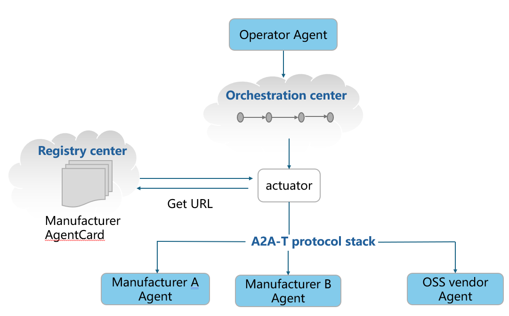
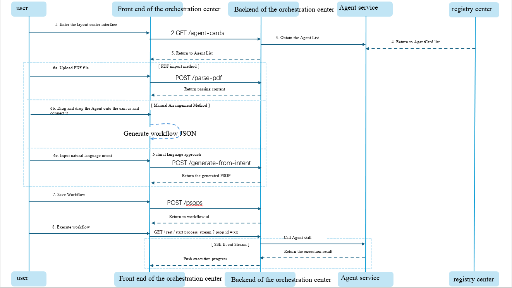

<!--
Copyright (c) 2026 Huawei Technologies Co., Ltd.
All Rights Reserved.

SPDX-License-Identifier: Apache-2.0

   Licensed under the Apache License, Version 2.0 (the "License"); you may
   not use this file except in compliance with the License. You may obtain
   a copy of the License at

        http://www.apache.org/licenses/LICENSE-2.0

   Unless required by applicable law or agreed to in writing, software
   distributed under the License is distributed on an "AS IS" BASIS, WITHOUT
   WARRANTIES OR CONDITIONS OF ANY KIND, either express or implied. See the
   License for the specific language governing permissions and limitations
   under the License.
-->
# 1 Project Introduction

## Background

From 2G to 5G, mobile communication networks have undergone four generations of evolution, with network scale and complexity growing exponentially. Traditional operations relying heavily on manual labor face challenges of high operational costs, pressure on user experience, and lack of business innovation. Since 2019, leading global operators have been promoting the Autonomous Network (AN) concept — transitioning networks from "manual operation" to "automated execution," ultimately achieving "autonomous governance," and classifying network autonomy levels as L1-L5.
AN L4's core characteristic is achieving end-to-end closed-loop autonomy in specific scenarios. To achieve L4, the problem of multi-vendor, cross-layer, cross-domain intelligent agent interconnection and collaboration must be solved. Although the industry currently has general agent protocols (such as A2A protocol) and orchestration tools (such as LangGraph) to address agent interconnection and collaboration, their application in the telecommunications domain faces issues such as network operations security risks, complex coding for operations engineers, and difficulty in reusing operations knowledge and tools. Therefore, OpenAN emerged.

## Core Vision

OpenAN is an autonomous network open-source project collection that supports the development and deployment of telecommunications intelligent agents through a series of open-source projects, enabling multi-vendor, cross-layer, cross-domain integration, and accelerating autonomous networks toward L4-L5.

- End-to-end closed-loop autonomous network: Accelerate cross-layer, cross-domain integration and deployment of telecommunications-specific agents, efficient multi-agent orchestration and collaboration, enabling global operators to accelerate the realization of AN L4.

- Vendor-neutral and open ecosystem: Based on industry standards (value scenario Solution Packages, agent interconnection protocols, etc.), advance vendor-neutral, industry-shared scenario-based "skills, components, knowledge, and practices," forming a telecommunications industry-wide cooperative ecosystem around AN, jointly improving the industry's AN level.

- Industry-led and future evolution: Drive OpenAN to become the de facto standard for the telecommunications industry, and explore integration and collaboration toward next-generation intelligent systems for AN L5.

## Project Architecture

OpenAN contains 6 modules, forming a complete intelligent agent collaboration framework:

1. A2A-T (Agent2Agent-Telecom) SDK: Provides intent templates for Agent interactions, validates message legality, provides message compression mechanisms, and improves interaction efficiency.

2. Registration and Orchestration: Provides AgentCard registration management capabilities, matches Skills by intent, and provides multi-functional agent process orchestration capabilities.

3. Scenario-based Practices: Operators/vendors share scenario-based practices (Solution packages), other operators can obtain references, modify and run them.

4. Runtime Engine: Responsible for parsing upper-level Agent intents, executing according to workflow, or auto-generating planning steps, and calling the telecommunications skill library as needed.

5. TSE(Telecommunications Strategy Evolution): Responsible for evaluating steps generated by the model, guiding the model prompt framework for continuous improvement.

6. Telecommunications Skills and Component Library: Responsible for skills, components, knowledge, etc. under various scenarios, contributed and shared by operators and vendors.

> **Note**: OpenAN's first open-source release includes A2A-T SDK, Registration and Orchestration, and Scenario-based Practices modules. Other modules will continue to evolve in subsequent versions.


# 2 Software Installation Guide

The overall software installation process is as follows:


![[photo]](figures/installflow.png)

## 2.1 System Requirements

This project is developed based on Python 3.12. Before compiling and installing, please ensure the target system meets the following requirements:

### Operating System

| Operating System | Minimum Version |
|---------|---------|
| Other Linux Distributions | Kernel 3.10+ |
| CentOS / RHEL | 7.0+ |
| Ubuntu | 18.04+ |
| Debian | 10+ |
> **Note**: Python 3.12 compilation requires a compiler supporting the C11 standard. GCC 5.0+ provides better optimization support. Glibc 2.17 is the minimum requirement for Python 3.12, and 2.28+ is recommended for better compatibility.


###  Verify System Environment

```bash
# Check GCC version
gcc --version

# Check Make version
make --version

# Check Glibc version
ldd --version
```

| Tool | Minimum Version | Recommended Version | View Command |
|-----|---------|---------|---------|
| GCC | 4.8.5 | 5.0+ | `gcc --version` |
| Make | 3.81 | 4.0+ | `make --version` |
| Glibc | 2.17 | 2.28+ | `ldd --version` |
> **Note**: Python 3.12 compilation requires a compiler supporting the C11 standard. GCC 5.0+ provides better optimization support. Glibc 2.17 is the minimum requirement for Python 3.12, and 2.28+ is recommended for better compatibility.

### Recommended Hardware Deployment Resources
| Node Type | Master Node Count | Worker Node Count | vCPU (cores) | Memory (GB) | Disk |
|--------|-------|-------|---------|--------|-----------|
| registry-center Node | 1 | 1 | 2 | 4 | System disk >= 100G |
| orchestration-center Node | 1 | 1 | 2 | 4 | System disk >= 100G |
| Database Node | 1 | 1 | 2 | 4 | System disk >= 100G |


### Minimum Deployment Resources
| Node Type | Master Node Count | Worker Node Count | vCPU (cores) | Memory (GB) | Disk |
|--------|-------|-------|---------|--------|----------|
| registry-center Node | 1 | 0 | 1 | 2 | System disk >= 50G |
| orchestration-center Node | 1 | 0 | 1 | 2 | System disk >= 50G |
| Database Node | 1 | 0 | 1 | 2 | System disk >= 50G |


### Node Requirements

For online environments, nodes must be able to connect to external networks. For offline environments, dependency packages must be pre-downloaded on a networked Linux machine with the same architecture as the target server (x86_64 or aarch64), then transferred to the target node for installation (see the [Quick Installation Guide](https://github.com/project-openan/openan-installation/blob/main/docs/en/quick-installation-guide.en.md)).<br>
Nodes can be accessed using the root user.<br>
The bootstrap node needs the tar tool installed.
> **Notice**: It is recommended that your node environment is clean, without any Kubernetes components installed, otherwise version conflicts may occur causing installation failure.


---

## 2.2 Quick Installation (Recommended)

OpenAN provides the unified installation tool [openan-installation](https://github.com/project-openan/openan-installation), which completes installation, verification, and uninstallation with a single command, without manually preparing runtimes and dependencies. It supports two types of environments: binary single-node (VM/bare metal) and containerized Kubernetes clusters. Each installation method follows the unified flow of "Preparation → Configuration Items → Installation → Verification → Uninstallation". For detailed instructions, see the [Quick Installation Guide](https://github.com/project-openan/openan-installation/blob/main/docs/en/quick-installation-guide.en.md).

### 2.2.1 Binary One-Click Installation (VM/Bare Metal)

The script automatically detects and installs missing dependencies (Python, Node.js, nginx, etc.), deploys the registry-center, orchestration-center backend and frontend, and automatically configures the unified Nginx entry point.

**Preparation**: A VM or bare-metal server that can access external networks (GitHub / PyPI / Node official sources), with root privileges.

**Configuration Items** (prompted interactively during installation, all with default values; you can press Enter to accept the defaults):

| Configuration Item | Description |
| ---- | ---- |
| Component selection | Passed in via the command line: `--reg` installs only the registry-center, `--orc` installs only the orchestration-center; defaults to installing all components. When installing only the orchestration-center, the remote registry-center address must be provided |
| LLM endpoint | Model name / API URL / API Key (masked input); can be skipped and configured after installation |
| Sensitive items | Database password, administrator password, etc. Use strong passwords in production environments |

**Installation**:

```bash
# Obtain the deployment tool
git clone https://github.com/project-openan/openan-installation.git
cd openan-installation/binary/one-click

# One-click installation (all components by default; see Configuration Items above)
bash install.sh

# Example: install only the registry center
bash install.sh --reg
```

After installation, the script checks that all processes are alive and ports are listening, and outputs the PID and log path of each service; a success message in the output indicates that the deployment is complete. If the installation fails, troubleshoot common causes based on the output (such as port conflicts or dependency download failures) and run the installation command again; if necessary, run `bash uninstall.sh` to clean up the environment and retry. For more failure scenarios and troubleshooting methods, see the [Quick Installation Guide](https://github.com/project-openan/openan-installation/blob/main/docs/en/quick-installation-guide.en.md).

**LLM endpoint configuration (optional)**: If the LLM endpoint was skipped during installation, it can be configured or reconfigured afterwards with the following command (with connectivity check and masked input):

```bash
bash configure_llm.sh --reg --orc
```

**Verification**:

```bash
# Verify the unified entry API; a non-5xx status code is expected
curl -sk -o /dev/null -w '%{http_code}\n' \
  https://127.0.0.1/registry/rest/v1/registry-center/agent-cards
```

Open `https://<server IP>/` in a browser; the orchestration-center frontend page should be displayed.

> **Note**: A non-5xx status code (e.g., `200`) from `curl` and the frontend page opening normally in the browser indicate a successful deployment. `127.0.0.1` in the command is an example address for local deployment; replace it with the actual server IP or domain for remote deployment. If a 5xx code is returned or the page is inaccessible, check the service logs at the log paths output during installation to locate the cause.

**Uninstallation**:

```bash
bash uninstall.sh           # Uninstall after interactive confirmation
bash uninstall.sh --force   # Skip confirmation (for automation)
```

After uninstallation, the project directory and the Nginx configuration are removed, while runtimes such as Python and Node.js are retained for reinstallation.

### 2.2.2 Containerized One-Click Installation (Kubernetes Cluster)

Deployed via Helm Chart, targeting production clusters.

**Preparation**: A Kubernetes (v1.33+) cluster with external network access, kubectl access, and cluster administrator privileges; Helm can be installed automatically by the wizard if missing.

**Configuration Items** (prompted by the installation wizard, or specified via a `--values` deployment file):

| Configuration Item | Description |
| ---- | ---- |
| Release name / namespace | Helm release and deployment namespace, defaults to `openan` / `openan` |
| Component switches | Select registry / orchestration / frontend as needed |
| Image and frontend type | Image tag; frontend type can be `portal` or `workflow-designer` |
| Database | Use in-cluster PostgreSQL, or external MySQL / PostgreSQL (connection information and credentials required) |
| LLM endpoints | Model name, API URL, and API Key for chat / embed / rerank models; written into models.yaml as a Secret by the wizard |
| Administrator initial password and access token | Portal administrator initial password (`OC_ADMIN_INITIAL_PASSWORD`) and registry access token |
| Ingress hostname and TLS (optional) | Configure according to the actual domain and certificates |

**Installation**:

```bash
git clone https://github.com/project-openan/openan-installation.git
cd openan-installation/containerized/online-install

# Run the interactive installation wizard (unattended deployment via --values is also supported)
bash install.sh
```

The installation takes approximately 10–20 minutes (depending on the network and cluster environment); after it completes, verify the deployment status with the commands below.

**Verification**:

```bash
helm status openan -n openan   # STATUS: deployed is expected
kubectl -n openan get pods     # All pods should be Running / Ready
curl -s -o /dev/null -w '%{http_code}\n' \
  http://<ingress-IP>/registry/rest/v1/registry-center/agent-cards   # Non-5xx expected
```

> **Note**: `STATUS: deployed` from `helm status`, all pods `Running` and `Ready` from `kubectl get pods`, and a non-5xx status code from the entry API indicate a successful deployment; if any pod is not ready, run `kubectl -n openan describe pod <pod>` to check the events, locate the cause, and re-run the installation command after the issue is fixed.

**Uninstallation**:

```bash
bash uninstall.sh
```

During uninstallation, choose whether to clean up the data as prompted.

> **Note**: The binary one-click installation requires the node to be able to access external networks. For offline single-node, offline cluster, and other scenarios, see the offline installation methods (binary offline installation, containerized offline installation, offline Compose installation) in the [Quick Installation Guide](https://github.com/project-openan/openan-installation/blob/main/docs/en/quick-installation-guide.en.md), or use [Manual Installation](#23-manual-installation).

---

## 2.3 Manual Installation

Applicable to scenarios that require customized systemd service management, connecting to an existing database cluster, or component-by-component source-level deployment. For detailed steps, see the [Manual Installation Guide](https://github.com/project-openan/openan-installation/blob/main/docs/en/manual-installation-guide.en.md), completed in the following order:

| Step | Content |
| ---- | ---- |
| 1. Dependency installation | Install Python (>= 3.12.11), PostgreSQL (>= 15.6), and NodeJS (>= 20.19, only required for building the orchestration-center frontend) |
| 2. Registry-center service installation | Obtain the source code, create a virtual environment, install dependencies, configure the database connection, then install as a systemd service and start it |
| 3. Orchestration-center service installation | Obtain the source code, create a virtual environment, install dependencies, configure the database connection, then install as a systemd service and start it |
| 4. Orchestration-center frontend deployment | Build the frontend static resources and configure Nginx hosting and the backend reverse proxy |

After installation, confirm the service status with the following commands; `active (running)` indicates a successful start:

```bash
systemctl status registry-center
systemctl status orchestration-center
```

---

## 2.4 A2A-T SDK Offline Installation Steps

A2A-T SDK includes a2a-t-sdk-python and a2a-t-sdk-java, which are the Python/Java implementations of the A2A-T protocol. a2a-t-sdk-python provides task prompt generation, prompt validation, and multi-round negotiation capabilities for client Agents and server Agents. a2a-t-sdk-java provides client prompt generation, server prompt validation, negotiation runtime, and A2A Java integration examples for Java Agents.

- a2a-t-sdk-python

[Installation and configuration instructions are in the a2a-t-sdk-python Developer Guide](https://github.com/project-openan/a2a-t-sdk-python/blob/main/docs/en/developer_guide.md)

The Python SDK source code is in the `a2a-t-sdk-python` repository, and the end-to-end demonstration samples are in the `a2a-t-samples` repository. Before running, you need to prepare Python 3.12+, and configure an available LLM service address and API Key.

- a2a-t-sdk-java

[Installation and configuration instructions are in the a2a-t-sdk-java Developer Guide](https://github.com/project-openan/a2a-t-sdk-java/blob/main/docs/en/developer_guide.md)

The Java SDK source code and examples are both in the `a2a-t-sdk-java` repository. Before running, you need to prepare JDK 17+, Maven, and configure an available LLM service address and API Key.

---

# 3 Quick Start

## 3.1 registry-center and orchestration-center



The registry-center is a service focused on unified Agent management, supporting centralized registration and management of Agents from different vendors, achieving controllable access and maintenance of multi-source Agents. Key features include:

- **Register AgentCard**: Supports registering Agents from different vendors to the center for unified management.
- **Query AgentCard List**: Query the list of AgentCards that meet specified conditions.
- **Query Specified AgentCard**: Find a unique AgentCard instance by AgentCard name and organization.
- **Update Specified AgentCard**: Update information of a specified AgentCard.
- **Delete Specified AgentCard**: Delete AgentCards that are no longer in use.
- **Semantic Search for AgentCard**: Search for matching AgentCards based on natural language semantics.

Through these features, the registry-center helps users efficiently integrate, maintain, and discover various Agents, providing foundational capabilities for upper-level orchestration and collaboration.

The orchestration-center is a visual orchestration platform for multi-agent collaboration, supporting the definition of invocation relationships and execution flows between Agents through a graphical workflow designer. The backend is based on a Python framework that parses flows and drives Agent collaboration, helping users efficiently build, manage, and run complex Agent collaboration workflows. Key features include:

- **PSOP (Parallel Standard Operating Procedure) Management**: Supports listing, detail querying, saving, and deleting workflows (PSOPs).
- **PDF Parsing**: Provides PDF file content parsing capabilities, providing data support for subsequent flow design.
- **Intelligent Planning**: Automatically generates workflow planning based on user requirements, lowering the orchestration threshold.
- **Agent Management**: Retrieves the full AgentCard list, facilitating understanding of available capabilities and invocation methods.
- **Natural Language PSOP Generation**: Generates executable orchestration flows directly from natural language intents.
- **Intent-based PSOP Retrieval**: Retrieves matching historical workflows based on natural language descriptions.
- **Real-time Flow Execution**: Supports starting PSOP execution in streaming mode, with real-time progress push for monitoring and debugging.

### 3.1.1 Start Services
#### 3.1.1.1 Start registry-center Service
[For startup instructions, see the Registry Center User Guide](https://github.com/project-openan/registry-center/blob/main/docs/en/Registry%20Center%20User%20Guide.md#starting-the-cli)

#### 3.1.1.2 Start orchestration-center Backend Service
[For startup instructions, see the Orchestration Center User Guide](https://github.com/project-openan/orchestration-center/blob/main/docs/en/Orchestration%20Center%20User%20Guide.md#222-start-the-orchestration-center-backend-service)

#### 3.1.1.3 Start orchestration-center Frontend Interface
[For startup instructions, see the Orchestration Center User Guide](https://github.com/project-openan/orchestration-center/blob/main/docs/en/Orchestration%20Center%20User%20Guide.md#223-install-frontend-dependencies-and-start)

### 3.1.2 Example Agent Introduction
  	 
This section uses the live event broadcasting assurance scenario as an example to introduce how multiple Agents collaborate to achieve end-to-end closed-loop autonomy.
  	 
**Scenario Background**

In the live event broadcasting scenario, network stability during the broadcast must be ensured to guarantee a smooth viewing experience for audiences. This scenario involves the collaboration of three intelligent agents: Live Streaming Agent, Assurance Agent, and RAN Agent.
  	 
**Agent Role Description**
  	 
| Agent Name | Responsibility |
| --- | --- |
| Live Streaming Agent | Responsible for parsing and monitoring event requirements |
| Assurance Agent | Responsible for generating assurance strategies and recovery strategies |
| RAN Agent | Responsible for radio network analysis, planning, and strategy execution |
  	 
**Collaboration Flow**
   
  The entire live event broadcasting assurance flow consists of two phases: assurance execution and assurance recovery:

- Phase 1: Assurance Execution Flow
```mermaid
  	 flowchart LR
  	     A[Live Streaming Agent<br/>Extract event route and business requirements] --> B[Live Streaming Agent<br/>Send requirements to Assurance Agent]
  	     B --> C[Assurance Agent<br/>Convert event assurance requirements to network requirements]
  	     C --> D[Assurance Agent<br/>Send network requirements to RAN Agent]
  	     D --> E[RAN Agent<br/>Analyze network current status]
  	     E --> F[RAN Agent<br/>Plan network strategy solution]
  	     F --> G[RAN Agent<br/>Execute network strategy solution]
  	     G --> H[Live Streaming Agent<br/>Real-time feedback of KQI metrics and task status]
 ```
- Phase 2: Assurance Recovery Flow
```mermaid
  	 flowchart LR
  	     H[Live Streaming Agent<br/>Real-time feedback of KQI metrics and task status] --> I[Assurance Agent<br/>Send network configuration recovery instructions]
  	     I --> J[RAN Agent<br/>Execute network configuration recovery]
 ```
  	 
The following video demonstrates the complete multi-Agent collaboration flow in the live event broadcasting assurance scenario, covering both the assurance execution and assurance recovery phases:


### 3.1.3 Start Example Agents
To quickly experience the complete flow, you can start the example Agent services included in the project.
```bash
cd {project path}/orchestration-center/samples
python -m samples.start_agents_server
```
This script will:
- Register multiple example Agents with the registry-center.
- Start the corresponding Agent services for the orchestration-center to invoke.
### 3.1.4 Core Flow Verification
After completing the above steps, you can experience OpenAN's core capabilities by following this flow:



1.Access the orchestration-center interface.

Open a browser and access `http://localhost:3003`

2.  Configure service address.

Click the gear icon in the upper right corner of the interface, modify the backend IP and port to the actual address of the orchestration-center backend, and save.

3.View Agent library.

The left side displays all Agents retrieved from the registry-center, which can be searched by name or function.

4.Create a workflow.
   
Click the `+` button and select the creation method: ([For detailed creation flow, see the Orchestration Center User Guide](https://github.com/project-openan/orchestration-center/blob/main/docs/en/Orchestration%20Center%20User%20Guide.md#3-usage))

| Method | Operation Description |
| --- | --- |
| PDF Import | Upload a PDF file, the system automatically parses and generates a PSOP |
| Manual Orchestration | Drag Agent cards to the canvas, define execution order through connections |
| Natural Language Generation | Enter business intent description, the backend automatically orchestrates and generates a PSOP |

5.Execute workflow
- Enter user intent, click the "Search Workflow" button
- Select the matching PSOP
- Click the `▶` button to execute, the right area displays the execution process in real time

## 3.2 A2A-T SDK

### 3.2.1 a2a-t-sdk-python

a2a-t-sdk-python is the Python implementation of the A2A-T protocol, providing task prompt generation, prompt validation, and multi-round negotiation capabilities for client Agents and server Agents. Key features include:

- **Task Prompt Generation**: The client generates A2A-T processed task prompt based on user natural language or structured input.
- **Task Prompt Validation**: The server validates the scenario, template, slot, and semantic consistency of the processed task prompt.
- **Multi-round Negotiation**: Supports four types of negotiation flows: information, clarification, feasibility, and fulfillment.
- **Prompt Resource Management**: Supports loading local scenario, slot, template, and system prompt resources.
- **LLM Adaptation**: Connects to external large models via OpenAIClient approach.

Through these capabilities, the Python SDK can help developers quickly build Python Agents that comply with A2A-T interaction specifications, and integrate with A2A protocol links, registry-center, and orchestration-center.

For detailed instructions, see:

- [a2a-t-sdk-python Developer Guide](https://github.com/project-openan/a2a-t-sdk-python/blob/main/docs/en/developer_guide.md)


### 3.2.2 a2a-t-sdk-java

a2a-t-sdk-java is the Java implementation of the A2A-T protocol, providing client prompt generation, server prompt validation, negotiation runtime, and A2A Java integration examples for Java Agents. Key features include:

- **Client Prompt Generation**: Generate A2A-T processed task prompt via `A2ATClient`.
- **Server Prompt Validation**: Validate the scenario, slot, and semantic consistency of the prompt via `A2ATServer`.
- **Negotiation Flow**: Supports multi-round information supplementation, clarification, feasibility confirmation, and fulfillment confirmation.
- **Maven Multi-module Project**: Organized by core, resources, llm, prompt, negotiation, client, server, and sample layers.

Through these capabilities, the Java SDK can help developers reuse A2A-T's task expression, validation, and negotiation capabilities in Java Agents, and discover target Agents through the registry-center.

For detailed instructions, see:

- [Java SDK Developer Guide](https://github.com/project-openan/a2a-t-sdk-java/blob/main/docs/en/developer_guide.md)
