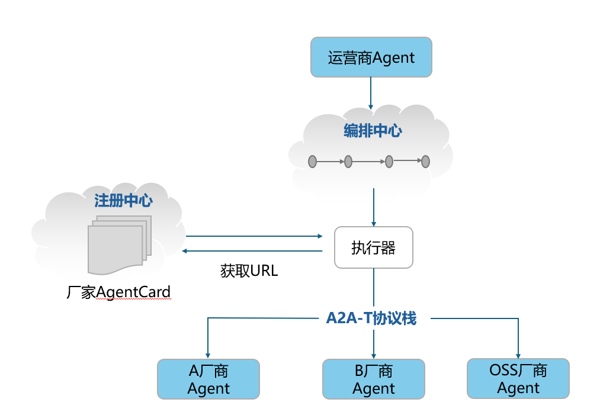
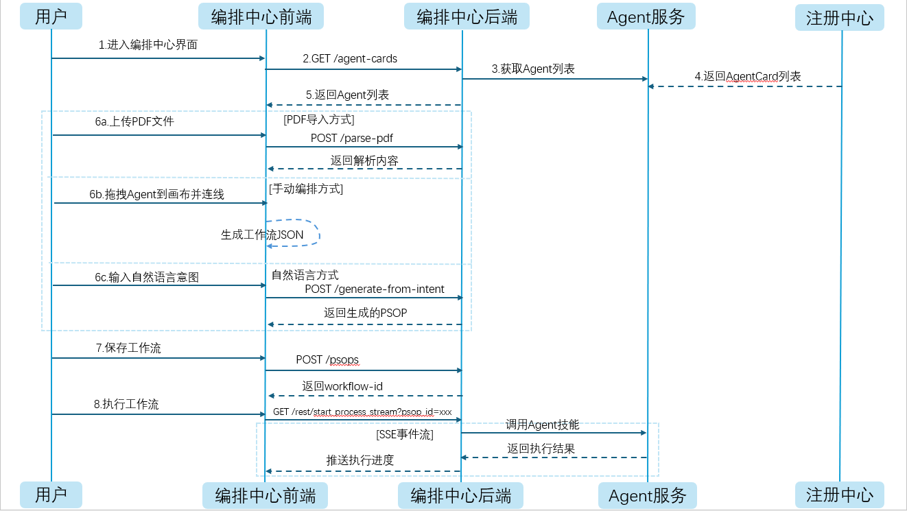

<!--
Copyright (c) 2026 Huawei Technologies Co., Ltd.
All Rights Reserved.

SPDX-License-Identifier: Apache-2.0

   Licensed under the Apache License, Version 2.0 (the "License"); you may
   not use this file except in compliance with the License. You may obtain
   a copy of the License at

        http://www.apache.org/licenses/LICENSE-2.0

   Unless required by applicable law or agreed to in writing, software
   distributed under the License is distributed on an "AS IS" BASIS, WITHOUT
   WARRANTIES OR CONDITIONS OF ANY KIND, either express or implied. See the
   License for the specific language governing permissions and limitations
   under the License.
-->
# 1 项目介绍

## 背景
从 2G 到 5G，移动通信网络经历了四代演进，网络规模和复杂度呈指数级增长。传统依赖大量人力的运维模式面临运营成本高、用户体验压力大、业务创新乏力的挑战。 2019 年起，全球领先运营商开始推动自智网络（Autonomous Network, AN）理念——让网络从"人工操作"走向"自动执行"，最终实现"自主治理"，并将网络自治水平分为L1-L5。
AN L4 的核心特征是：在特定场景下实现端到端闭环自治，而要实现 L4，就必须解决多厂商、跨层、跨域的智能体互联协作问题。当前业界虽然有通用的智能体协议（如A2A协议）和编排工具（如LangGraph）解决智能体互联协作问题，但在通信领域应用存在网络运维安全风险、运维工程师编码复杂、运维知识和工具复用难等问题，因此OpenAN应运而生。

## 核心愿景

OpenAN是一个自智网络开源项目集，通过一系列开源项目支撑通信智能体的开发和部署，使能多厂商、跨层、跨域集成，加速自智网络迈向L4-L5。

- 端到端闭环自治网络：加速电信专属智能体的跨层、跨域对接集成和上线部署，多智能体高效编排与协同，使能全球运营商加速实现AN L4。

- 厂商中立与开放生态：基于行业标准（价值场景Solution Package、智能体互联协议等），推进厂商中立、产业共享的场景化“技能、组件、知识和实践”，围绕AN形成电信全产业合作生态，共同提升产业AN水平。

- 行业主导与未来演进：推动OpenAN成为电信行业事实标准，探索面向AN L5下一代智能化系统的集成与协作。

## 项目架构

OpenAN 包含 6 个模块，构成了完整的智能体协作框架：

1 、A2A-T（Agent2Agent-Telecom）SDK：提供Agent交互之间的意图模板，校验消息合法性，提供消息压缩机制，提升交互效率。

2、注册与编排：提供AgentCard的注册管理能力，按意图匹配Skill，提供多个功能侧agent流程编排能力。

3、场景化实践：运营商/厂商分享场景化实践（Solution package），其他运营商可以获取参考，改造运行。

4、执行引擎：负责对上解析上层Agent意图，按照workflow执行，或自生成规划步骤，按需调用通信技能库。

5、通信策略演进：负责对模型生成的步骤进行评价，牵引模型提示框架持续改进。

6、通信技能与组件库：负责各种场景下的技能、组件、知识等，运营商、厂商分享贡献。

> **说明**：OpenAN首次开源发布 A2A-T SDK、注册与编排、场景化实践模块，其他模块后续版本持续演进。


# 2 软件安装指南

整体软件安装流程如下：

![[photo]](figures/installflow.png)

## 2.1 系统要求

本项目基于 Python 3.12 开发，编译安装前请确保目标系统满足以下要求：

### 操作系统

| 操作系统 | 最低版本 |
|---------|---------|
| 其他 Linux 发行版 | 内核 3.10+ |
| CentOS / RHEL | 7.0+ |
| Ubuntu | 18.04+ |
| Debian | 10+ |
> **说明**：Python 3.12 编译需要支持 C11 标准的编译器，GCC 5.0+ 可提供更好的优化支持。Glibc 2.17 是 Python 3.12 的最低要求，建议使用 2.28+ 以获得更好的兼容性。


###  验证系统环境

```bash
# 检查 GCC 版本
gcc --version

# 检查 Make 版本
make --version

# 检查 Glibc 版本
ldd --version
```

| 工具 | 最低版本 | 推荐版本 | 查看命令 |
|-----|---------|---------|---------|
| GCC | 4.8.5 | 5.0+ | `gcc --version` |
| Make | 3.81 | 4.0+ | `make --version` |
| Glibc | 2.17 | 2.28+ | `ldd --version` |
> **说明**：Python 3.12 编译需要支持 C11 标准的编译器，GCC 5.0+ 可提供更好的优化支持。Glibc 2.17 是 Python 3.12 的最低要求，建议使用 2.28+ 以获得更好的兼容性。

### 硬件部署建议资源
| 节点类型   | 主节点数量 | 从节点数量 | vCPU(个) | 内存(GB) | 硬盘        |
|--------|-------|-------|---------|--------|-----------|
| 注册中心节点 | 1     | 1     | 2       | 4      | 系统盘>=100G |
| 编排中心节点 | 1     | 1     | 2       | 4      | 系统盘>=100G |
| 数据库节点  | 1     | 1     | 2       | 4      | 系统盘>=100G |


### 最小部署建议资源
| 节点类型   | 主节点数量 | 从节点数量 | vCPU(个) | 内存(GB) | 硬盘       |
|--------|-------|-------|---------|--------|----------|
| 注册中心节点 | 1     | 0     | 1       | 2      | 系统盘>=50G |
| 编排中心节点 | 1     | 0     | 1       | 2      | 系统盘>=50G |
| 数据库节点  | 1     | 0     | 1       | 2      | 系统盘>=50G |


### 节点要求

在线环境要求节点可以连通外部网络；离线环境需提前在网络已连通的Linux机器（与目标服务器架构一致，x86_64或aarch64）上下载依赖包，再传输到目标节点安装（参见[快速安装指导](https://github.com/project-openan/openan-installation/blob/main/docs/zh/quick-installation-guide.zh.md)）。<br>
节点可以使用root用户登录。<br>
引导节点上需要安装tar工具。
> **须知**：建议您的节点环境足够干净，未安装任何Kubernetes组件，否则可能会发生版本冲突导致安装失败。


---

## 2.2 快速安装（推荐）

OpenAN 提供统一安装工具 [openan-installation](https://github.com/project-openan/openan-installation)，一条命令完成安装、校验与卸载，无需手工准备运行时与依赖，支持二进制单机（虚拟机/裸金属）与 Kubernetes 集群容器化两类环境。每种安装方式均按“准备 → 配置项 → 安装 → 校验 → 卸载”的统一流程组织。详细指导见[快速安装指导](https://github.com/project-openan/openan-installation/blob/main/docs/zh/quick-installation-guide.zh.md)。

### 2.2.1 二进制一键安装（虚拟机/裸金属）

脚本自动探测并安装缺失依赖（Python、Node.js、nginx 等），完成注册中心、编排中心后端与前端部署，并自动配置 Nginx 统一入口。

**准备**：一台可访问外网（GitHub / PyPI / Node 官方源）的虚拟机或裸金属服务器，root 权限。

**配置项**（安装过程中以交互方式提示，均有默认值，可直接回车）：

| 配置项 | 说明 |
| ---- | ---- |
| 组件选择 | 命令行传入：`--reg` 仅安装注册中心，`--orc` 仅安装编排中心，缺省全量安装；仅安装编排中心时需提供远程注册中心地址 |
| LLM 端点 | 模型名 / API URL / API Key（掩码输入），可跳过，安装后补配 |
| 敏感项 | 数据库密码、管理员密码等，生产环境请设置强密码 |

**安装**：

```bash
# 获取部署工具
git clone https://github.com/project-openan/openan-installation.git
cd openan-installation/binary/one-click

# 一键安装（缺省安装全部组件，组件选择见上方配置项）
bash install.sh
```

LLM 端点若在安装时跳过，可在安装后补配或重配（支持连通性校验与掩码输入）：

```bash
bash configure_llm.sh --reg --orc
```

**校验**：

```bash
# 验证统一入口 API，期望返回非 5xx 状态码
curl -sk -o /dev/null -w '%{http_code}\n' \
  https://127.0.0.1/registry/rest/v1/registry-center/agent-cards
```

浏览器访问 `https://<服务器IP>/` 应打开编排中心前端页面。

**卸载**：

```bash
bash uninstall.sh           # 交互式确认后卸载
bash uninstall.sh --force   # 跳过确认（用于自动化）
```

### 2.2.2 容器化集群安装（Kubernetes）

基于 Helm Chart 部署，面向生产集群。

**准备**：可访问外网的 Kubernetes（v1.33+）集群，kubectl 访问与集群管理员权限；helm 缺失时向导可自动安装。

**配置项**（向导交互提示，或使用 `--values` 部署文件指定）：

| 配置项 | 说明 |
| ---- | ---- |
| release 名称 / 命名空间 | Helm release 与部署命名空间，默认 `openan` / `openan` |
| 组件开关 | registry / orchestration / frontend 按需选择 |
| 镜像与前端类型 | 镜像 tag，前端类型可选 `portal` / `workflow-designer` |
| 数据库 | 使用集群内 PostgreSQL，或外部 MySQL / PostgreSQL（需提供连接信息与凭证） |
| LLM 端点 | chat / embed / rerank 模型的名称、API URL 与 API Key，由向导写入 models.yaml 并创建 Secret |
| 管理员初始密码与访问令牌 | 门户管理员初始密码（`OC_ADMIN_INITIAL_PASSWORD`）与 registry 访问令牌 |
| ingress 主机名与 TLS（可选） | 按实际域名与证书配置 |

**安装**：

```bash
git clone https://github.com/project-openan/openan-installation.git
cd openan-installation/containerized/online-install

# 运行交互式安装向导（也可使用 --values 无人值守部署）
bash install.sh
```

**校验**：

```bash
helm status openan -n openan   # 期望 STATUS: deployed
kubectl -n openan get pods     # 全部 Pod 应为 Running / Ready
curl -s -o /dev/null -w '%{http_code}\n' \
  http://<ingress-IP>/registry/rest/v1/registry-center/agent-cards   # 期望非 5xx
```

**卸载**：

```bash
bash uninstall.sh
```

> **说明**：一键二进制安装要求节点可连通外部网络。离线单机、离线集群等其他场景，请参见[快速安装指导](https://github.com/project-openan/openan-installation/blob/main/docs/zh/quick-installation-guide.zh.md)中的离线安装方式（二进制离线安装、容器化离线安装、离线 Compose 安装），或采用[手动安装](#23-手动安装)。

---

## 2.3 手动安装

适用于需要自定义 systemd 服务管理、外接已有数据库集群或逐组件源码级部署的场景。详细步骤见[手动安装指导](https://github.com/project-openan/openan-installation/blob/main/docs/zh/manual-installation-guide.zh.md)，按以下顺序依次完成：

| 步骤 | 内容 |
| ---- | ---- |
| 1. 依赖安装 | 安装 Python（>= 3.12.11）、PostgreSQL（>= 15.6）、NodeJS（>= 20.19，仅编排中心前端构建需要） |
| 2. 注册中心服务安装 | 获取源码、创建虚拟环境、安装依赖、配置数据库连接，安装为 systemd 服务并启动 |
| 3. 编排中心服务安装 | 获取源码、创建虚拟环境、安装依赖、配置数据库连接，安装为 systemd 服务并启动 |
| 4. 编排中心前端部署 | 构建前端静态资源，配置 Nginx 托管及后端反向代理 |

安装完成后，可通过以下命令确认服务状态，显示 `active (running)` 即为启动成功：

```bash
systemctl status registry-center
systemctl status orchestration-center
```

---

## 2.4 A2A-T SDK 离线安装步骤

A2A-T SDK分为a2a-t-sdk-python和a2a-t-sdk-java两种，是 A2A-T 协议的 Python/Java 实现，a2a-t-sdk-python面向客户端 Agent 和服务端 Agent 提供任务提示词生成、提示词校验和多轮协商能力。a2a-t-sdk-java面向 Java Agent 提供客户端提示词生成、服务端提示词校验、协商运行时和 A2A Java 集成样例。

- a2a-t-sdk-python

[安装和配置方式见 Python SDK 的开发指南](https://github.com/project-openan/a2a-t-sdk-python/blob/main/docs/zh/%E5%BC%80%E5%8F%91%E6%8C%87%E5%8D%97.md)

Python SDK 源码位于 `a2a-t-sdk-python` 仓库，端到端演示样例位于 `a2a-t-samples` 仓库。SDK 运行前需准备 Python 3.12+，并配置可用的 LLM 服务地址和 API Key。

- a2a-t-sdk-java

[安装和配置方式见 Java SDK 的开发指南](https://github.com/project-openan/a2a-t-sdk-java/blob/main/docs/zh/%E5%BC%80%E5%8F%91%E6%8C%87%E5%8D%97.md)

Java SDK 源码和示例均位于 `a2a-t-sdk-java` 仓库。运行前需准备 JDK 17+、Maven，并配置可用的 LLM 服务地址和 API Key。

---

# 3 快速入门

## 3.1 注册中心和编排中心



注册中心是一个专注于Agent统一管理的服务，支持用户将来自不同厂商的Agent进行集中注册与管理，实现多源Agent的可控接入与维护。主要功能包括：

- **注册AgentCard**：支持将不同厂商的Agent注册到中心，统一纳管。
- **查询AgentCard列表**：根据指定条件查询符合条件的AgentCard列表。
- **查询指定AgentCard**：按AgentCard名称和组织精确查找唯一的AgentCard实例。
- **更新指定AgentCard**：更新指定AgentCard的信息。
- **删除指定AgentCard**：删除不再使用的AgentCard。
- **按语义检索AgentCard**：根据自然语言语义检索相匹配的AgentCard。

通过这些功能，注册中心可以帮助用户高效整合、维护与发现各类 Agent，为上层编排与协同提供基础能力。

编排中心是一个面向多智能体（Agent）协作的可视化编排平台，支持通过图形化工作流设计器定义 Agent 之间的调用关系与执行流程。后端基于 Python 框架解析流程并驱动 Agent 协同工作，帮助用户高效构建、管理和运行复杂的 Agent 协作流程。主要功能包括：

- **PSOP(Parallel Standard Operating Procedure)管理**：支持工作流（PSOP）的列表查看、详情查询、保存与删除操作。
- **PDF 解析**：提供 PDF 文件内容解析能力，为后续流程设计提供数据支持。
- **智能规划**：根据用户需求自动生成工作流规划，降低编排门槛。
- **Agent 管理**：获取全量 AgentCard 列表，便于了解可用能力与调用方式。
- **自然语言生成 PSOP**：通过自然语言意图直接生成可执行的编排流程。
- **意图检索 PSOP**：根据自然语言描述，检索匹配的历史工作流。
- **实时流程执行**：支持以流式方式启动 PSOP 执行，并实时推送运行进展，便于监控与调试。

### 3.1.1 启动服务
#### 3.1.1.1 启动注册中心服务
[启动方式见注册中心的用户指南](https://github.com/project-openan/registry-center/blob/main/docs/zh/%E6%B3%A8%E5%86%8C%E4%B8%AD%E5%BF%83%E7%94%A8%E6%88%B7%E6%8C%87%E5%8D%97.md#%E5%90%AF%E5%8A%A8cli)

#### 3.1.1.2 启动编排中心后端服务
[启动方式见编排中心的用户指南](https://github.com/project-openan/orchestration-center/blob/main/docs/zh/%E7%94%A8%E6%88%B7%E6%8C%87%E5%8D%97.md#222-%E5%90%AF%E5%8A%A8%E7%BC%96%E6%8E%92%E4%B8%AD%E5%BF%83%E5%90%8E%E7%AB%AF%E6%9C%8D%E5%8A%A1)

#### 3.1.1.3 启动编排中心前端界面
[启动方式见编排中心的用户指南](https://github.com/project-openan/orchestration-center/blob/main/docs/zh/%E7%94%A8%E6%88%B7%E6%8C%87%E5%8D%97.md#223-%E5%AE%89%E8%A3%85%E5%89%8D%E7%AB%AF%E4%BE%9D%E8%B5%96%E5%B9%B6%E5%90%AF%E5%8A%A8)

### 3.1.2 示例Agent介绍
 	 
本章节以赛事直播保障场景为例，介绍多个Agent如何协同工作，实现端到端的闭环自治。
 	 
**场景背景**

在赛事直播场景中，需要保证直播过程的网络稳定，确保观众获得流畅的观看体验。该场景涉及Live Streaming Agent、Assurance Agent和RAN Agent三个智能体的协作。
 	 
**Agent角色说明**
 	 
| Agent名称 | 职责 |
| --- | --- |
| Live Streaming Agent | 负责赛事需求的解析与监控 |
| Assurance Agent | 负责保障策略及其恢复策略的生成 |
| RAN Agent | 负责无线网络的分析、规划与策略执行 |
 	 
**协作流程**
  
  整个赛事直播保障流程分为保障执行和保障恢复两个阶段：

- 阶段一：保障执行流程
```mermaid
 	 flowchart LR
 	     A[Live Streaming Agent<br/>提取赛事路线和业务需求] --> B[Live Streaming Agent<br/>下发需求给Assurance Agent]
 	     B --> C[Assurance Agent<br/>将赛事保障需求转换为网络需求]
 	     C --> D[Assurance Agent<br/>下发网络需求给RAN Agent]
 	     D --> E[RAN Agent<br/>分析网络现状]
 	     E --> F[RAN Agent<br/>规划网络策略方案]
 	     F --> G[RAN Agent<br/>执行网络策略方案]
 	     G --> H[Live Streaming Agent<br/>实时反馈KQI指标及任务状态]
 ```
- 阶段二：保障恢复流程
```mermaid
 	 flowchart LR
 	     H[Live Streaming Agent<br/>实时反馈KQI指标及任务状态] --> I[Assurance Agent<br/>下发恢复网络配置指令]
 	     I --> J[RAN Agent<br/>执行网络配置恢复]
 ```
 	 
以下视频展示了赛事直播保障场景中多Agent协作的完整流程，涵盖保障执行与保障恢复两个阶段：


### 3.1.3 启动示例 Agent
为了快速体验完整流程，可以启动项目自带的示例 Agent 服务。
```bash
cd {项目路径}/orchestration-center/samples
python -m samples.start_agents_server
```
该脚本会：
- 向注册中心注册多个示例 Agent。
- 启动对应的 Agent 服务，供编排中心调用。
### 3.1.4 核心流程验证
完成上述步骤后，您可以按照以下流程体验 OpenAN 的核心能力：



1. 访问编排中心界面。

打开浏览器访问 `http://localhost:3003`

2.  配置服务地址。

单击界面右上角的齿轮图标，将后端 IP 和端口修改为编排中心后端的实际地址，保存。

3. 查看 Agent 库。

左侧展示从注册中心获取的所有 Agent，可通过名称或功能进行搜索。

4. 创建工作流。
   
单击 `+` 按钮，选择创建方式：([具体创建流程见编排中心用户指南](https://github.com/project-openan/orchestration-center/blob/main/docs/zh/%E7%94%A8%E6%88%B7%E6%8C%87%E5%8D%97.md#3-%E4%BD%BF%E7%94%A8))

| 方式 | 操作说明 |
| --- | --- |
| PDF 导入 | 上传 PDF 文件，系统自动解析并生成 PSOP |
| 手动编排 | 将 Agent 卡片拖拽到画布，通过连线定义执行顺序 |
| 自然语言生成 | 输入业务意图描述，后台自动编排生成 PSOP |

5. 执行工作流
- 输入用户意图，单击“检索工作流”按钮
- 选择匹配的 PSOP
- 单击 `▶` 按钮执行，右侧区域实时显示执行过程

## 3.2 A2A-T SDK

### 3.2.1 a2a-t-sdk-python

a2a-t-sdk-python 是 A2A-T 协议的 Python 实现，面向客户端 Agent 和服务端 Agent 提供任务提示词生成、提示词校验和多轮协商能力。主要功能包括：

- **任务提示词生成**：客户端根据用户自然语言或结构化输入生成 A2A-T processed task prompt。
- **任务提示词校验**：服务端校验 processed task prompt 的场景、模板、槽位和语义一致性。
- **多轮协商**：支持 information、clarification、feasibility、fulfillment 四类协商流程。
- **提示词资源管理**：支持本地场景、槽位、模板和系统提示词资源加载。
- **LLM 适配**：通过 OpenAIClient 方式接入外部大模型。

通过这些能力，Python SDK 可以帮助开发者快速构建符合 A2A-T 交互规范的 Python Agent，并与 A2A 协议链路、注册中心和编排中心配合集成。

详细说明见：

- [Python SDK 开发指南](https://github.com/project-openan/a2a-t-sdk-python/blob/main/docs/zh/%E5%BC%80%E5%8F%91%E6%8C%87%E5%8D%97.md)

### 3.2.2 a2a-t-sdk-java

a2a-t-sdk-java 是 A2A-T 协议的 Java 实现，面向 Java Agent 提供客户端提示词生成、服务端提示词校验、协商运行时和 A2A Java 集成样例。主要功能包括：

- **客户端提示词生成**：通过 `A2ATClient` 生成 A2A-T processed task prompt。
- **服务端提示词校验**：通过 `A2ATServer` 校验 prompt 的场景、槽位和语义一致性。
- **协商流程**：支持多轮信息补充、澄清、可行性确认和履约确认。
- **Maven 多模块工程**：按 core、resources、llm、prompt、negotiation、client、server、sample 分层组织。

通过这些能力，Java SDK 可以帮助开发者在 Java Agent 中复用 A2A-T 的任务表达、校验和协商能力，并通过注册中心发现目标 Agent。

详细说明见：

- [Java SDK 开发指南](https://github.com/project-openan/a2a-t-sdk-java/blob/main/docs/zh/%E5%BC%80%E5%8F%91%E6%8C%87%E5%8D%97.md)
